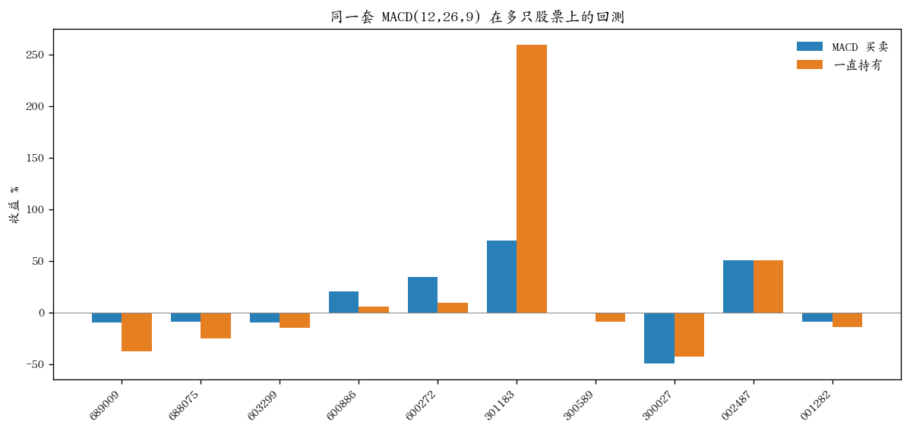

# 07 — 用多只股票回测 MACD 交易系统

把 06 的买卖规则原样拿到多只股票上各跑一遍。不改参数，不加手续费，也不换指标。06 只说明一只股票的一段日 K；这里看同一套规则在不同股票上差多少。

```bash
python3 backtest.py
python3 backtest.py 10
```

默认抽 10 只。数字是抽取只数，不是股票代码。

## 规则

和 [`06-用MACD指标做简单交易系统`](../06-用MACD指标做简单交易系统/README.md) 相同，直接调用那里的 `simulate()`：

- 金叉按当天收盘满仓买入，死叉按当天收盘全部卖出
- 参数 12、26、9
- 前 35 根上的交叉不用
- 期末还没死叉的，用最后一根收盘价估值
- 一直持有：从第 35 根收盘买到最后一根收盘

## 股票怎么抽

01 的列表按代码从大到小排，第一页几乎都是科创板。若只拿第一页，回测看的是同一类股票。

这里先问全市场大约有多少只，再按这个顺序均匀取点。10 只就是大约每 10% 取 1 只，沪市和深市都会进到样本里。每次运行抽到的代码会随列表变化，不是一份固定股票池。

## 结果怎么读

每只打印：完成的买卖笔数、策略收益、一直持有的收益。

最后两行是这批样本的平均和中位数，以及策略收益高于一直持有的有几只。平均会被个别大涨大跌拉开，中位数看这批股票里更靠中间的结果。

下图是一次 `python3 backtest.py 10` 的对照。蓝柱是 MACD 买卖，橙柱是一直持有。



这是腾讯接口当前能拿到的那段日 K，大约三百个交易日，不是更长的历史，也不是以后还会这样。样本只有十几只时，多一只或少一只，平均数就会变。
