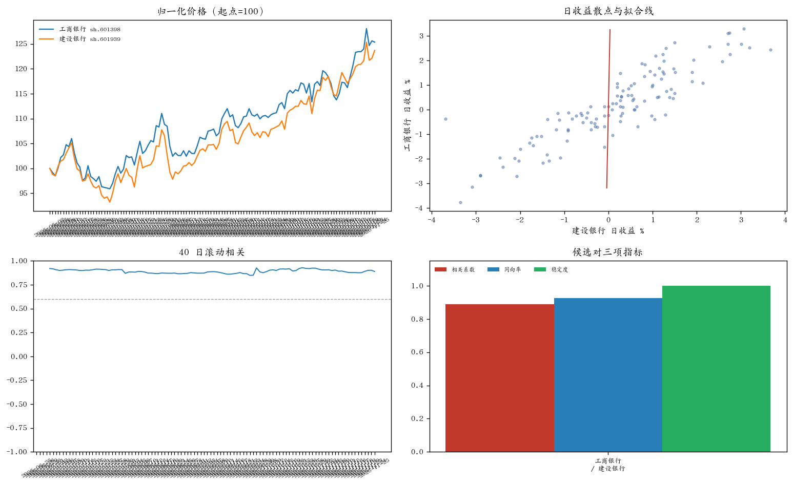

# 08 — 同涨同跌的股票配对

专栏第一篇。找 2–3 只走势「总体类似」的股票：A 涨 B 也涨，A 跌 B 也跌。通常它们是同一个品种、同一条产业链，或者被同一批资金按同一个逻辑买。

```bash
cd 08-同涨同跌股票配对
python3 similar.py                         # 扫股票池，挑最像的一对并画图
python3 similar.py --codes sh.601398 sh.601939 sh.601288
```

数据来自 Klang 本地缓存 `~/.klang/day/<code>day.json`，先确保已经用 Klang 的 `tools/eltdx_updater.py` 更新过。开盘前的零成交量占位 K 线会被剔掉。

## 思路

只看相关系数容易误判：两只股票可以天天同向、但幅度差很多；也可以在少数暴涨日把相关系数拉得很高，平时各走各的。这里把「像」拆成四件事一起看：

1. **方向像不像**：两边都动了的日子里，同向天数占比（同向率）。
2. **幅度像不像**：日收益 Pearson 相关、Spearman 相关，以及 B 每涨 1% 时 A 平均涨多少（beta）。
3. **是不是一直像**：40 日滚动相关大于 0.6 的比例（稳定度），避免只靠一段行情撑起来。
4. **谁先动**：A 今天与 B 昨天、A 昨天与 B 今天的相关谁更高。同涨同跌未必同步，可能有先后。

综合分 `0.45×相关 + 0.35×同向率 + 0.20×稳定度` 只用于排序，不是预测分。

## 股票池

本地股票列表的 `tdxbk/tdxgn` 是空的，所以先用 [`universe.csv`](universe.csv) 演示。三列：`group,code,name`。把你想研究的同类股票放进同一个 group，脚本只在组内两两比较，避免不同行业被大盘一起拉着涨、算出假的高相关。

也可以完全跳过股票池，直接用 `--codes` 指定 2–3 只。

## 一次实际结果

`python3 similar.py` 在 120 个交易日、19 只股票上找到 9 组：

| A | B | 相关 | 同向率 | beta |
| --- | --- | --- | --- | --- |
| 工商银行 sh.601398 | 建设银行 sh.601939 | 0.89 | 93% | 0.88 |
| 工商银行 sh.601398 | 农业银行 sh.601288 | 0.88 | 92% | 0.82 |
| 中芯国际 sh.688981 | 华虹宏力 sh.688347 | 0.81 | 84% | 0.49 |
| 山西汾酒 sh.600809 | 泸州老窖 sz.000568 | 0.82 | 86% | 0.88 |

三张图：归一化价格、日收益散点与拟合线、40 日滚动相关。工商银行/建设银行这一对的相关长期在 0.85 以上；中芯国际/华虹宏力 beta 只有 0.49，说明方向很像但幅度差一半。



完整指标在 [`pairs.csv`](pairs.csv)，文字版在 [`report.md`](report.md)。

## 还没解决的问题

- 大盘共同上涨会把所有股票的相关都抬高。下一步应该先对指数回归取残差，再看残差相关，剩下的才是「同类自己的东西」。
- 同涨同跌到什么程度就不再是两个独立的票，而是一个价差交易？beta 明显偏离 1 时，价差会不会回归？
- A 跌而 B 没跌的那几天，是 B 更强，还是配对关系正在失效？需要事件视角，不只是统计量。

这段只是把走势放在一起看，不代表基本面同类，也不代表以后还这样。
